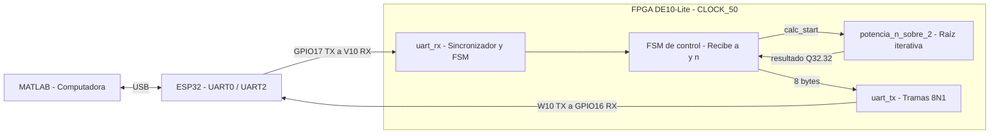
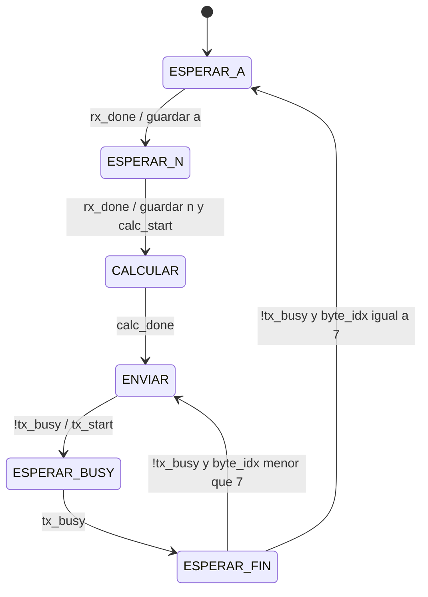
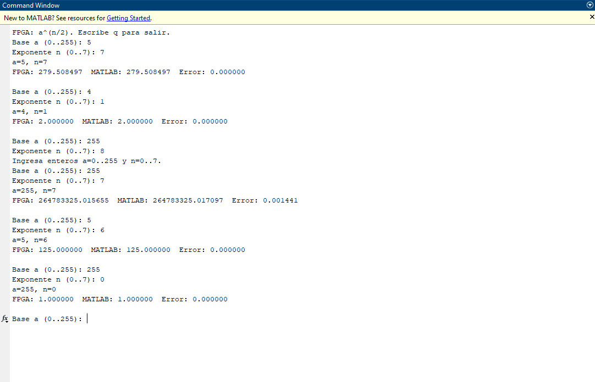
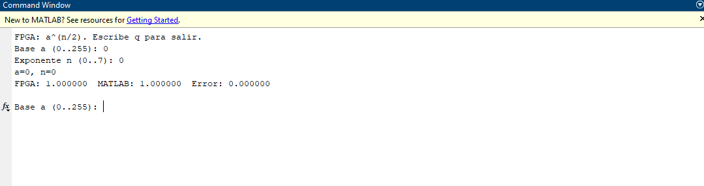

# Práctica 4: Comunicación bidireccional UART entre FPGA y MATLAB mediante ESP32

**Materia:** Sistemas Embebidos  
**Universidad:** Universidad de las Américas Puebla (UDLAP)  
**Integrantes:** Ana Paola Vargas González (180549) y Oscar Pelayo Alonso Pérez (183729)  
**Fecha:** 30 de octubre de 2026

---

## Resumen

En esta práctica implementamos una comunicación serial de ida y vuelta entre una computadora y una FPGA DE10-Lite. MATLAB envía datos por USB a un ESP32, que funciona como puente y los retransmite por UART a la FPGA. Primero desarrollamos la versión base, en la que la FPGA recibe un byte, le suma uno y devuelve el resultado. Después implementamos el punto extra: recibir una base $a$ entre 0 y 255 y un exponente $n$ entre 0 y 7 para calcular $a^{n/2}$.

Como el resultado del punto extra puede tener decimales y superar el rango de un byte, usamos una representación de punto fijo **Q32.32** y enviamos el resultado en ocho bytes. La FPGA calcula la raíz cuadrada mediante un algoritmo iterativo que utiliza corrimientos, comparaciones y restas; MATLAB reconstruye el número recibido y lo compara con su propio cálculo. En simulación verificamos las **2048 combinaciones** posibles, con un error absoluto máximo de **0.003606**. Las pruebas físicas mostraron resultados consistentes con la simulación.

---

## 1. Objetivo

Diseñar, simular e implementar en Verilog un sistema de comunicación UART bidireccional a **9600 baudios**, en formato **8N1**, entre una computadora y una FPGA DE10-Lite, usando un ESP32 como puente USB–UART y MATLAB para enviar, recibir y validar los datos.

El sistema debe realizar inicialmente la operación $x+1$ y, como punto extra, calcular $a^{n/2}$ y devolver el resultado con su parte decimal.

---

## 2. Estado del arte y fundamento teórico

### 2.1. Comunicación UART y trama 8N1

UART es un sistema de comunicación serial asíncrono. Al no existir un reloj compartido entre los dispositivos, ambos deben configurarse con la misma velocidad de transmisión. En el formato **8N1** cada trama utiliza un bit de inicio en 0, ocho bits de datos (primero el menos significativo), ningún bit de paridad y un bit de paro en 1. Cuando no se está transmitiendo, la línea permanece en alto [1].

La tarjeta DE10-Lite trabaja con un reloj de 50 MHz. A 9600 baudios, cada bit tiene una duración aproximada de:

$$
N=\frac{f_{\mathrm{CLK}}}{\mathrm{baud}}=\frac{50\,000\,000}{9600}\approx5208\ \text{ciclos}
$$

$$
T_{\mathrm{bit}}=\frac{1}{9600}\approx104.17\ \mu\mathrm{s}
$$

El receptor detecta el flanco de bajada del bit de inicio, espera aproximadamente medio bit (**2604 ciclos**) y muestrea los siguientes bits en la parte central de su intervalo. Además, la señal RX pasa por un sincronizador de dos flip-flops para reducir el riesgo de metaestabilidad al entrar al dominio del reloj de la FPGA.

### 2.2. ESP32 como puente USB–UART

El ESP32 se utiliza como intermediario entre la computadora y la FPGA. La UART0 es la interfaz que se comunica con la computadora mediante el puerto USB de la placa; la UART2 se utiliza con los GPIO16 (RX) y GPIO17 (TX) para intercambiar datos con la DE10-Lite [2].

La comunicación entre ambas tarjetas se realiza con señales lógicas de **3.3 V** y con una tierra común. Esto no debe confundirse con una conexión RS232 convencional, ya que ese estándar utiliza niveles eléctricos distintos y requiere un transceptor para conectarse a los GPIO [3, 4].

### 2.3. Representación en punto fijo Q32.32

En la versión base basta un byte para representar la respuesta, pero el punto extra puede producir números mayores que 255 y con parte fraccionaria.

Por ejemplo:

$$
5^{7/2}=279.508497\ldots
$$

Por ese motivo utilizamos una representación de **64 bits** en formato **Q32.32**: 32 bits para la parte entera y 32 para la fraccionaria. El número se almacena como un entero escalado:

$$
I=\left\lfloor a^{n/2}\,2^{32}\right\rfloor
$$

Y el valor representado se recupera mediante:

$$
\text{valor}=\frac{I}{2^{32}}
$$

El paso mínimo de la fracción es:

$$
2^{-32}\approx2.33\times10^{-10}
$$

Así, la FPGA procesa únicamente enteros y transmite los 64 bits del resultado en **ocho bytes**. MATLAB se encarga de reconstruir el entero y dividirlo entre $2^{32}$.

Como referencia, en Q2.2 el número 1.65 se almacena como:

$$
\lfloor1.65\times4\rfloor=6
$$

Es decir, $01.10_2$, que representa 1.5. El ejemplo muestra cómo la cantidad de bits fraccionarios determina la precisión.

### 2.4. Cálculo de la raíz cuadrada

Para obtener la raíz cuadrada sin utilizar operaciones de punto flotante en la FPGA, empleamos el algoritmo de raíz cuadrada entera **bit a bit** [5].

En cada iteración se bajan dos bits del radicando, se compara el residuo con el término de prueba y, si corresponde, se realiza una resta y se agrega un bit al resultado. Las operaciones necesarias son corrimientos, comparaciones y restas.

Para calcular directamente la raíz en Q32.32 usamos:

$$
\sqrt{a\,2^{64}}=\sqrt{a}\,2^{32}
$$

Como $a$ es de 8 bits, el radicando ocupa hasta **72 bits**. Al procesarlo en parejas de bits, el cálculo requiere **36 iteraciones**.

---

## 3. Planteamiento del experimento e implementación

### 3.1. Herramientas utilizadas

- **FPGA:** Terasic DE10-Lite con Intel MAX 10 (10M50DAF484C7G).
- **Descripción de hardware:** Verilog.
- **Síntesis e implementación:** Quartus Prime Lite 21.1.
- **Simulación:** Icarus Verilog y visualización de señales.
- **Puente de comunicación:** ESP32 programado desde Arduino IDE.
- **Interfaz en computadora:** MATLAB con `serialport`.
- **Comunicación:** UART 9600 baudios, 8N1.

### 3.2. Arquitectura general



El ESP32 únicamente reenvía los datos; la operación matemática se ejecuta en la FPGA. La comunicación de regreso utiliza la misma ruta en sentido inverso.

### 3.3. Conexión de pines

| Señal | Pin de la FPGA | Conexión | Función |
|---|---|---|---|
| `CLOCK_50` | P11 | — | Reloj de 50 MHz |
| `RESET_N` | B8 (`KEY0`) | — | Reinicio activo en bajo |
| `UART_RX` | V10 (JP1, pin 1) | GPIO17 (TX del ESP32) | Recepción serial |
| `UART_TX` | W10 (JP1, pin 2) | GPIO16 (RX del ESP32) | Transmisión serial |
| `GND` | GND de JP1 | GND del ESP32 | Tierra común |

Los pines de transmisión y recepción se conectan **cruzados**: TX del ESP32 con RX de la FPGA, y TX de la FPGA con RX del ESP32. Ambas tarjetas deben compartir GND.

### 3.4. Versión base: incrementar el byte recibido

La primera implementación recibe un valor de 8 bits, calcula $x+1$ y transmite la respuesta por UART.

El receptor `uart_rx` está construido como una máquina de estados con cuatro etapas: **IDLE, START, DATA y STOP**. Incorpora la sincronización de la entrada y comprueba que el bit de paro sea válido antes de generar `data_valid`.

Por su parte, `uart_tx` construye una trama de diez bits con el bit de inicio, ocho bits de datos y el bit de paro. Un contador mantiene cada bit durante aproximadamente 5208 ciclos de reloj, mientras la señal `busy` indica que la transmisión se encuentra activa.

La salida de la versión base también es de ocho bits. Por ello, cuando se recibe 255, el incremento genera 0 debido al desbordamiento de ese tamaño de dato.

En el ESP32 se utiliza un puente transparente en ambas direcciones. Se eliminó el mensaje enviado por `Serial.println` al iniciar, ya que ese texto llegaba al mismo puerto leído por MATLAB y podía confundirse con los bytes de la respuesta.

### 3.5. Punto extra: potencia $a^{n/2}$

El módulo del punto extra recibe dos bytes: la base $a$ (0 a 255) y el exponente $n$ (0 a 7).

Para simplificar la implementación, separamos la potencia en su componente entera y su posible raíz:

$$
a^{n/2}=a^{\lfloor n/2\rfloor}\cdot(\sqrt{a})^{n\bmod2}
$$

La parte entera del exponente se obtiene con `n[2:1]` y selecciona uno de los valores $1$, $a$, $a^2$ o $a^3$.

El bit `n[0]` indica si hace falta multiplicar por $\sqrt{a}$.

El fragmento principal del módulo `potencia_n_sobre_2` es:

```verilog
case (n[2:1])
    2'd0: potencia_entera <= 24'd1;               // a^0
    2'd1: potencia_entera <= {16'd0, a};          // a^1
    2'd2: potencia_entera <= {8'd0, cuadrado_in}; // a^2
    2'd3: potencia_entera <= cubo_in;             // a^3
endcase

impar <= n[0];

// Al completar los 36 pasos de la raíz:
if (impar)
    resultado_q32 <= {4'd0, producto};
else
    resultado_q32 <= {8'd0, potencia_entera, 32'd0};
```

Si $n$ es par, el resultado se obtiene de la potencia entera, desplazada 32 bits para expresarla en Q32.32. Si $n$ es impar, se multiplica esa potencia por la raíz calculada de manera iterativa.

El control general se implementa con una **FSM de seis estados**:



El resultado se envía en **ocho bytes, comenzando por el menos significativo** (*little-endian*).

El control espera a que `tx_busy` se active y se desactive antes de iniciar la transmisión del siguiente byte.

Para un exponente fuera del rango admitido, el diseño contempla devolver cero; adicionalmente, MATLAB valida los límites y no envía entradas inválidas.

MATLAB envía `uint8([a, n])`, espera a recibir los ocho bytes (con un tiempo de espera de hasta tres segundos), reconstruye el valor como:

$$
I=\sum_{i=0}^{7}b_i2^{8i}
$$

Y obtiene el resultado:

$$
\text{resultado}=\frac{I}{2^{32}}
$$

Finalmente, calcula la referencia con `a^(n/2)` y presenta el error absoluto.

---

## 4. Casos de estudio y pruebas

### 4.1. Simulación de la versión base

Para agilizar la simulación de UART, en los testbench se configuró un reloj de **1 MHz** y una velocidad de **10 000 baudios**, equivalente a 100 ciclos por bit.

Los parámetros de frecuencia y baud rate permiten conservar el comportamiento lógico del sistema.

| Dato enviado | Resultado esperado | Resultado obtenido | Estado |
|---:|---:|---:|---|
| 10 | 11 | 11 | Correcto |
| 25 | 26 | 26 | Correcto |
| 100 | 101 | 101 | Correcto |
| 200 | 201 | 201 | Correcto |
| 255 | 0 | 0 | Correcto; desbordamiento de 8 bits |
| 0 | 1 | 1 | Correcto |

Todos los casos de `tb_practica4` devolvieron el resultado esperado.

### 4.2. Simulación del módulo de cálculo

La primera prueba del punto extra evaluó las **256 bases** y los **8 exponentes** posibles:

$$
256\times8=2048\ \text{combinaciones}
$$

Las 2048 combinaciones superaron la validación con tolerancia de **0.005** frente al cálculo en punto flotante del testbench.

El error absoluto máximo observado fue de **0.003606**, para $a=254$ y $n=7$.

Cada operación empleó aproximadamente 37 ciclos de reloj; la raíz recorre sus 36 iteraciones.


**Figura 1.** Simulación del módulo de cálculo. Después de recibir el segundo byte, `calc_start` inicia la operación, `paso` recorre los valores de 0 a 35 y `calc_done` señala su finalización.

En el diagrama se observa que `rx_done` genera un pulso cuando se recibe el segundo byte, seguido de la activación de `calc_start`. Posteriormente, `calc_busy` permanece activo durante la ejecución del algoritmo y finalmente se genera `calc_done`, indicando que el resultado está listo para transmitirse.

### 4.3. Simulación del sistema completo

La prueba integral envió los bytes correspondientes a $a=5$ y $n=7$ a través de `UART_RX` y verificó los ocho bytes devueltos por `UART_TX`.

La respuesta en Q32.32 fue:

```text
0x00000117822CDEAA
```

Una vez escalada, corresponde a **279.508497**, el resultado esperado de $5^{7/2}$ con seis decimales.


**Figura 2.** Simulación del sistema completo. Se reciben dos bytes por `UART_RX`, se realiza el cálculo y posteriormente se transmiten los ocho bytes del resultado por `UART_TX`.

En la simulación se identifican los cambios de estado de la máquina de control, el pulso de recepción de datos y el incremento de `byte_idx` conforme se transmiten los ocho bytes del resultado. Esto confirma que la FPGA no intenta transmitir el siguiente byte mientras la UART continúa ocupada.

### 4.4. Implementación física y uso de recursos

Después de validar la simulación, se compiló el proyecto en Quartus con `top_uart_de10lite_extra` como entidad superior.

Se programaron tanto el ESP32 como la FPGA; posteriormente se cerró el Monitor Serial de Arduino para que MATLAB pudiera acceder al puerto y ejecutar `bidireccional_extra.m`.

Los recursos reportados por Quartus fueron:

| Recurso | Utilización |
|---|---:|
| Elementos lógicos | 534 / 49 760 (aprox. 1 %) |
| Registros | 345 |
| Pines | 4 / 360 |
| Multiplicadores embebidos de 9 bits | 11 / 288 (aprox. 4 %) |
| Frecuencia máxima reportada, esquina lenta a 85 °C | 61.52 MHz |

**Distribución aproximada de elementos lógicos por módulo:**

| Módulo | Elementos lógicos |
|---|---:|
| `potencia_n_sobre_2` | 300 |
| `uart_rx` | 71 |
| `uart_tx` | 66 |
| FSM del módulo superior | 105 |

La cantidad de recursos utilizados demuestra que el sistema ocupa una parte pequeña de la capacidad total de la FPGA.

El módulo de cálculo concentra la mayor parte de la lógica debido a las operaciones de potencia y raíz cuadrada. Sin embargo, el uso de recursos sigue siendo bajo, permitiendo agregar otras funciones al diseño si fuera necesario.

### 4.5. Pruebas reales con MATLAB

Se comprobaron casos con exponentes pares e impares, valores extremos de la base, exponente fuera de rango y el caso $0^0$.

| Base $a$ | Exponente $n$ | Resultado FPGA | Resultado MATLAB | Error absoluto mostrado |
|---:|---:|---:|---:|---:|
| 5 | 7 | 279.508497 | 279.508497 | 0.000000 |
| 4 | 1 | 2.000000 | 2.000000 | 0.000000 |
| 255 | 8 | — | — | Rechazado por MATLAB |
| 5 | 6 | 125.000000 | 125.000000 | 0.000000 |
| 255 | 7 | 264783325.015655 | 264783325.017097 | 0.001441 |
| 255 | 0 | 1.000000 | 1.000000 | 0.000000 |
| 0 | 0 | 1.000000 | 1.000000 | 0.000000 |



**Figura 3.** Consola de MATLAB. La salida incluye los valores recibidos desde la FPGA, la referencia calculada por MATLAB y el error de cada prueba. También se muestra la validación del exponente fuera de rango.

Los resultados indican que el sistema realiza correctamente las operaciones para exponentes enteros y fraccionarios.

En el caso de $a=255$ y $n=7$, aparece una diferencia pequeña entre la FPGA y MATLAB, debido a la aproximación de la raíz cuadrada mediante el algoritmo de punto fijo.



**Figura 4.** Caso $a=0$, $n=0$: tanto la FPGA como MATLAB presentan el resultado 1 y un error de 0.

Estas capturas documentan el recorrido completo de cada petición: MATLAB transmite los dos datos, el ESP32 los reenvía, la FPGA realiza la operación y devuelve los ocho bytes al programa para su reconstrucción y comprobación.

---

## 5. Análisis de resultados

Los valores que se obtuvieron físicamente coincidieron con los observados en simulación. Por ejemplo, para $a=255$ y $n=7$ la FPGA devolvió **264783325.015655** en ambos casos, mientras que MATLAB calculó **264783325.017097**.

Esto indica que la transmisión preservó el orden y contenido de los ocho bytes; la pequeña diferencia respecto al valor de referencia proviene de la aproximación numérica utilizada para la raíz.

La raíz se trunca al representarse con 32 bits fraccionarios. Aunque el error de esa raíz es menor que $2^{-32}$, en el caso de un exponente impar se multiplica por la potencia entera correspondiente.

Así, para el peor caso considerado, se tiene la cota:

$$
\varepsilon < \frac{a^3}{2^{32}}\leq\frac{255^3}{2^{32}}\approx0.00386
$$

El error máximo medido en las 2048 combinaciones, **0.003606**, se mantiene por debajo de esa cota.

Para exponentes pares, el resultado no requiere una raíz y coincide exactamente en los casos evaluados. En resultados pequeños con exponentes impares, como $5^{7/2}$, el error no se aprecia a seis decimales.

Para $0^0$ se adoptó el valor 1, que también devuelve MATLAB.

En cuanto al tiempo, el cálculo utiliza cerca de **37 ciclos**. Con un reloj de 50 MHz esto equivale a:

$$
T_{\mathrm{calc}}\approx\frac{37}{50\,000\,000}=0.74\ \mu\mathrm{s}
$$

En comparación, recibir dos tramas UART de diez bits a 9600 baudios requiere aproximadamente:

$$
T_{\mathrm{RX}}\approx\frac{20}{9600}=2.08\ \mathrm{ms}
$$

Y transmitir las ocho tramas de respuesta:

$$
T_{\mathrm{TX}}\approx\frac{80}{9600}=8.33\ \mathrm{ms}
$$

Por lo tanto, **más del 99.9 % del tiempo del intercambio corresponde a la comunicación serial**, no a la operación matemática.

Si se quisiera aumentar la velocidad general del sistema, el primer cambio útil sería incrementar el baud rate.

También es importante que MATLAB termine de recibir los ocho bytes antes de enviar una nueva petición, para no mezclar respuestas.

Durante el análisis temporal de Quartus apareció inicialmente un *slack* negativo de **−15.26 ns**.

El proyecto no tenía un archivo `.sdc` que declarara el reloj de la tarjeta, por lo que el análisis utilizó una suposición temporal que no correspondía a los 50 MHz reales.

La frecuencia máxima reportada fue **61.52 MHz**, superior a la frecuencia de operación de 50 MHz; para dejar la restricción correctamente especificada se debería añadir al archivo `.sdc` una instrucción como:

```tcl
create_clock -name CLOCK_50 -period 20.000 [get_ports {CLOCK_50}]
```

Respecto al uso de recursos, más de la mitad de los elementos lógicos se concentraron en `potencia_n_sobre_2`.

Las multiplicaciones que intervienen en $a^3$ y en el producto final también utilizan multiplicadores embebidos, mientras que el cálculo iterativo de la raíz se basa en restas y desplazamientos.

En general, las simulaciones, las pruebas físicas y el análisis de recursos muestran que la implementación cumple con los objetivos de comunicación y procesamiento establecidos para la práctica.

---

## 6. Conclusiones

En esta práctica conseguimos establecer una comunicación bidireccional entre MATLAB y la FPGA DE10-Lite utilizando un ESP32 como puente.

Primero verificamos el intercambio de un byte con la operación $x+1$ y después ampliamos el protocolo para enviar dos bytes de entrada y recibir ocho bytes de salida.

Esto nos permitió entender mejor el funcionamiento de UART, particularmente la importancia de configurar la misma velocidad en ambos extremos, muestrear los bits en el momento correcto y validar el bit de paro.

El punto extra demostró que el problema principal no era transmitir datos por UART, sino representar correctamente un resultado que puede ser grande y contener decimales.

El formato Q32.32 resolvió esa necesidad sin recurrir a números de punto flotante dentro de la FPGA.

Además, el método de raíz cuadrada bit a bit permitió implementar la operación mediante 36 pasos basados en comparaciones, corrimientos y restas.

El ESP32 facilitó la comunicación con la computadora sin utilizar un convertidor USB–TTL adicional, aunque fue necesario evitar mensajes de arranque que contaminaran las respuestas.

Por último, MATLAB permitió automatizar las pruebas, reconstruir los 64 bits y comparar los resultados con una referencia numérica.

Las pruebas de simulación y las mediciones físicas fueron consistentes, y el error máximo observado se mantuvo dentro de la precisión esperada para el método empleado.

---

## 7. Cuestionario

### 1. ¿Qué diferencia existe entre UART y RS232?

UART es el sistema que transmite y recibe datos seriales asíncronos mediante una trama con bits de inicio, datos y paro.

RS232 es un estándar de interfaz eléctrica que establece niveles de voltaje y características de las señales.

Se pueden transmitir datos UART a través de una interfaz RS232, pero para hacerlo es necesario adaptar los niveles eléctricos [4].

### 2. ¿Por qué no es correcto conectar una salida RS232 directamente al GPIO de la FPGA?

Los GPIO de la DE10-Lite utilizan niveles lógicos de 3.3 V, mientras que RS232 maneja voltajes positivos y negativos distintos.

Conectarlo directamente puede provocar lecturas incorrectas o dañar la tarjeta.

Se necesita un transceptor adaptador, como un MAX232 [3, 4].

### 3. ¿Qué función tiene el baud rate?

Establece la velocidad de transmisión y, por tanto, la duración de cada bit.

A 9600 baudios, cada bit dura aproximadamente 104.17 microsegundos.

Como UART es asíncrono, transmisor y receptor necesitan utilizar velocidades compatibles para interpretar bien la trama.

### 4. ¿Por qué se cruzan las señales TX y RX?

Porque la salida de transmisión de un dispositivo debe conectarse a la entrada de recepción del otro: TX del ESP32 con RX de la FPGA y viceversa.

Si se conectaran dos salidas TX entre sí, se produciría un conflicto eléctrico y los dispositivos no recibirían los datos de la forma esperada.

### 5. ¿Qué ventajas ofrece MATLAB en esta práctica?

Permite enviar bytes específicos, recibir las respuestas de la FPGA, reconstruir los resultados en Q32.32, realizar varias pruebas de manera repetible y comparar automáticamente cada salida con el cálculo numérico de referencia.

### 6. ¿Cuál es la función del ESP32?

Sirve como puente bidireccional entre el puerto USB de la computadora y la UART de la FPGA.

Reenvía los bytes sin ejecutar la operación matemática, ya que el cálculo se realiza en la DE10-Lite [2].

---

## 8. Repositorio de código

El código fuente utilizado en esta práctica se encuentra en este repositorio. Incluye los módulos de recepción y transmisión UART, el módulo de cálculo para el punto extra, los módulos superiores, los testbench de simulación y los scripts de MATLAB empleados para la validación.

---

## 9. Referencias

[1] D. M. Harris y S. L. Harris, *Digital Design and Computer Architecture*, 2.ª ed., Morgan Kaufmann, 2013, cap. 8.

[2] Espressif Systems, *ESP32 Technical Reference Manual*, capítulo «UART Controller». [Documento técnico](https://www.espressif.com/sites/default/files/documentation/esp32_technical_reference_manual_en.pdf).

[3] Terasic Inc., *DE10-Lite User Manual*, junio de 2020. [Manual de la tarjeta](https://www.mouser.com/datasheet/2/598/DE10-Lite_User_Manual-1100361.pdf).

[4] Texas Instruments, *Interface Circuits for TIA/EIA-232-F*, reporte SLLA037A, 2002. [Reporte técnico](https://www.ti.com/lit/pdf/slla037).

[5] H. S. Warren, *Hacker's Delight*, 2.ª ed., Addison-Wesley, 2013, cap. 11.
